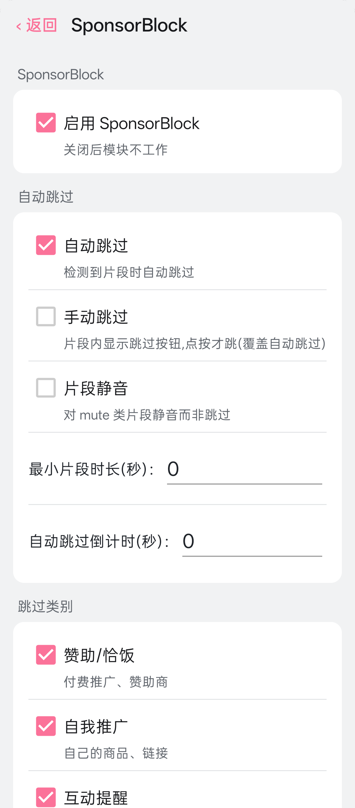

# 哔哩哔哩空降助手

哔哩哔哩空降助手是一个需要 Xposed 框架的模块。它使用 SponsorBlock 社区片段数据，在哔哩哔哩国内版播放视频时跳过或标记赞助内容、片头、自我推广等片段。

[国内下载（123 网盘）](https://1818248298.share.123pan.cn/123pan/PGo3jv-8iReH?pwd=vG4N)

## 适用范围

安装前请确认设备和客户端符合以下条件：

| 项目 | 要求 |
| --- | --- |
| 哔哩哔哩客户端 | **国内版 9.12.0**（包名 `tv.danmaku.bili`） |
| Android | Android 8.0 或更高版本 |
| 设备架构 | ARM64（`arm64-v8a`） |
| 运行环境 | 已 Root，并安装支持现代 libxposed API 101 的 Vector 或 LSPosed |

## 功能

- 自动跳过片段；也可改为手动点击跳过，或只把静音类片段静音（三种方式三选一）。
- 首页推荐会隐藏带整段视频推广标签的视频卡片；播放页“更多视频”和 UP 主投稿列表会隐藏带“整段广告”标签的视频；关注流/动态中命中“整段广告”标签后会移除整条动态。可通过设置中的“隐藏恰饭推广视频”关闭。
- 对标记为静音的片段静音播放。
- 在播放器进度条显示不同类别的片段标记（使用内置分类配色）。
- 可按类别启用或关闭片段。
- 可选择显示跳过提示、扣减剩余时长和统计跳过次数。

支持的普通片段类别包括赞助/恰饭、自我推广、互动提醒、开场动画、结束画面、回顾/概要、非音乐片段、填充内容和精彩时刻。整段视频标签另支持广告、品牌合作和无偿/自我推广：首页推荐会隐藏带任一整段标签的视频卡片；播放页“更多视频”和 UP 主投稿列表只隐藏带“整段广告”标签的视频；关注流/动态中的视频命中“整段广告”标签后会移除整条动态。整段标签不会阻止视频正常播放，也不会导致整段视频被自动跳过。实际效果取决于所用数据源中是否已有对应视频的标签。

## 效果预览

截图以缩略尺寸展示，点击图片可查看原图。

  
  

## 安装与启用

1. 获取可信来源提供的模块 APK，并像普通应用一样安装。
2. 打开 Vector 或 LSPosed 管理界面，启用“哔哩哔哩空降助手”模块。
3. 将模块作用域设为“哔哩哔哩”（`tv.danmaku.bili`）。
4. 强制停止并重新打开哔哩哔哩；必要时重启设备，让模块生效。

模块**没有桌面图标**。启用后，设置入口位于哔哩哔哩「我的」页面中的 **哔哩哔哩空降助手**。

## 设置说明

在「我的 → 哔哩哔哩空降助手」中可以调整模块设置。所有设置都在同一页：

| 设置 | 说明 |
| --- | --- |
| 启用 SponsorBlock | 模块总开关。关闭后不再处理片段。 |
| 跳过方式 | 三选一：**自动跳过**（命中即跳过）/ **手动跳过**（片段内显示按钮，点按才跳）/ **片段静音**（只静音静音类片段，不跳过任何片段）。 |
| 跳过类别 | 选择要处理哪些类别的片段。 |
| 界面显示 | 控制跳过提示、进度条标记、剩余时长扣减、跳过统计。 |
| 隐藏恰饭推广视频 | 首页推荐隐藏带任一整段视频标签的卡片；播放页“更多视频”和 UP 主投稿隐藏带“整段广告”标签的视频；关注流/动态命中“整段广告”后移除整条动态。 |
| 统计 | 查看累计跳过次数与节省时长，可随时重置。 |

进度条标记使用内置的分类配色；服务器地址等参数固定在模块内，不需要也不能在界面上修改。

## 数据与隐私

- 查询片段时，模块只向模块内置的 SponsorBlock 兼容服务（`https://bsbsb.top`）请求数据。请求使用视频 ID 的 SHA-256 前 4 位作为查询前缀，客户端再按完整视频 ID 匹配结果。
- 模块没有片段提交功能：不会向服务端发送用户标识、视频标识或片段时间等信息。
- 模块不登录哔哩哔哩账号，不接管账号，也不修改哔哩哔哩服务端请求；没有遥测或埋点。设置保存在本机。

## 常见问题

**安装后桌面上找不到图标？** 这是正常的。设置入口在哔哩哔哩「我的」页面，模块本身没有桌面启动图标。

**模块已安装但没有效果？** 请确认框架中已启用模块、作用域包含 `tv.danmaku.bili`，并检查哔哩哔哩是否为国内版 9.12.0 。修改作用域或模块状态后，请强制停止并重新打开哔哩哔哩。

**部分视频没有跳过片段？** 片段来自社区数据，并非每个视频都有人提交；也请检查设置里的跳过类别开关。

**整段视频标签会影响正常播放吗？** 不会。过滤只作用于首页推荐、播放页“更多视频”、UP 主投稿列表和关注流/动态；首页推荐过滤广告、品牌合作及无偿/自我推广标签，其他入口只过滤“整段广告”标签。关注流/动态命中后移除的是整条动态，不会自动跳过视频。

**更新哔哩哔哩后失效？** 当前适配 9.12.0，其他新版可能需要模块更新适配。

## 致谢与许可

- [ch6vip/lsposed-bili-sponsorblock](https://github.com/ch6vip/lsposed-bili-sponsorblock)：本项目移植所基于的上游项目（MIT）。
- [小电视空降助手 · hanydd/BilibiliSponsorBlock](https://github.com/hanydd/BilibiliSponsorBlock)：数据源与分类体系。
- [SponsorBlock](https://sponsor.ajay.app/)：片段数据与 API 协议。
- [Vector](https://github.com/JingMatrix/Vector) / [LSPosed](https://github.com/LSPosed/LSPosed)：模块运行框架。

本项目采用 [MIT 许可证](LICENSE)。
